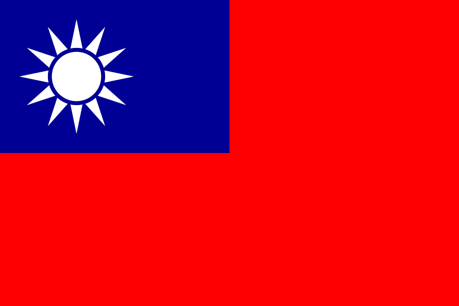

# QuadFight 🇹🇼

 **English** · [繁體中文](README.zh-TW.md)

> **Free, non-commercial hobby project.** QuadFight is a personal project made for fun and for the author's own play.
> It is free: no ads, no in-app purchases, no donations, nothing is sold, and no money is made from it.
> It is an independent work and is not affiliated with, endorsed by, or sponsored by any other game or company.

A single-player falling-block puzzle game made with Godot 4.7: title screen, scores, local leaderboard,
a VS-CPU mode with 12 fighters and special attacks, and 2-player versus. Keyboard, gamepad and touch controls.

**Play now in the browser:** <https://jfcc-github.github.io/quadFight/>

## Downloads

Get the latest build from the [Releases page](https://github.com/JFCC-GITHUB/quadFight/releases/latest).

| Platform | File | How to run |
|---|---|---|
| Windows 10/11 (64-bit) | `QuadFight-<version>-windows-x64.zip` | Unzip, double-click `QuadFight.exe` |
| macOS 11+ (Apple Silicon & Intel) | `QuadFight-<version>-macos-universal.zip` | Unzip, move `QuadFight.app` to Applications, open it (see below) |
| Linux (x86-64) | `QuadFight-<version>-linux-x86_64.tar.gz` | `tar xzf …`, then `./QuadFight.x86_64` |
| Web (any modern browser, iOS Safari too) | `QuadFight-<version>-web.zip` or the link above | Host the folder over HTTP, or just use the live link |

Each archive contains the game plus `LICENSE`, `THIRD_PARTY_NOTICES.md`, `PRIVACY.md` and the Godot licence texts.

### The builds are not code-signed
Code-signing certificates cost money and this is a free hobby project, so the Windows and macOS builds are **unsigned**.
Your system will warn you the first time. The game contains no network code and collects no data (see [PRIVACY.md](PRIVACY.md)).
You can check that a download is the one published by the author with `SHA256SUMS.txt` (attached to every release):

```
sha256sum -c SHA256SUMS.txt          # Linux / macOS: shasum -a 256 -c SHA256SUMS.txt
Get-FileHash QuadFight-*.zip         # Windows PowerShell, compare with the file
```

- **Windows (SmartScreen):** "Windows protected your PC" → **More info** → **Run anyway**.
- **macOS (Gatekeeper):** right-click `QuadFight.app` → **Open** → **Open**. If macOS says the app is "damaged", run
  `xattr -dr com.apple.quarantine /Applications/QuadFight.app` once in Terminal.
- **Linux:** if it does not start, `chmod +x QuadFight.x86_64`. Needs a GPU/driver with OpenGL 3.3 (GL Compatibility renderer).

## Controls
| | Keyboard | Gamepad | Touch |
|---|---|---|---|
| Move left / right | ← → / A D | D-pad / left stick | `<` `>` |
| Soft drop | ↓ / S | D-pad down | `v` |
| Rotate | ↑ X / Z | A / B | ROTATE |
| Hard drop | Space | D-pad up / Y | DROP |
| Hold | C / Shift | X | HOLD |
| Pause | P / Esc | Start | ⏸ top right |

Keys are rebindable in OPTIONS → KEYS.

## Game modes
- **PLAY** – endless single-player with a local leaderboard.
- **VS CPU** – play against the computer (Lv 1–20; it has input lag, thinks, and makes mistakes like a person). The first to top out loses.
  12 fighters, each with a special attack. Play a **LADDER** (one opponent, level goes up per win) or a **TOURNAMENT**
  (5 random fighters, then a "dark" copy of your own fighter as the boss; continues; bonus car-smashing stage).
  - CPU level = reaction speed, movement speed, mistake rate (Lv 1: ~28 % of pieces misplaced, slow; Lv 10: almost no mistakes, strong human speed; Lv 20: top human).
  - Clearing lines attacks the opponent: 1 line ≈ 1–2 garbage cells, 2 ≈ 3–4, 3 ≈ 5–7, 4 ≈ 8–10 (each extra combo +1, max 10); grey cells land at random columns.
  - Your clears first cancel your own incoming garbage; the rest is sent to the opponent. Incoming garbage is shown in INCOMING and by a red bar beside the board.
  - Your win/loss record is kept per level.
- **PRACTICE** – one unrecorded fight against a chosen opponent; rematch from the result card.
- **2 PLAYERS** – local versus on one computer (two keyboards halves / two gamepads) or on a tablet (two sets of touch buttons).

## Options (title screen or pause menu → OPTIONS)
- **COLORS** – 4 block themes (Candy / Neon / Pastel / Colorblind), 3 backgrounds (Nebula / Midnight / Sunset).
- **SOUND** – separate on/off and volume for sound and music; 2 sound styles (Arcade / Soft & Relaxed); 7 original music styles
  (Super Robot [default] / Chiptune / Synthwave / Chill / Lo-fi Cafe / Bossa Breeze / Music Box).
- **CONTROLS / KEYS** – touch layout (Classic / Thumbs), hand swap, key-repeat speed, ghost piece, key bindings.
- Settings are saved locally (browser storage on the web) and applied on the next start.

## Art and music
- Visual assets are generated by Python scripts in `tools/` (Pillow + numpy) into `assets/`: `gen_assets.py` (blocks, backgrounds, logo, icons),
  `gen_fighters.py`, `gen_fx.py`, `gen_car.py`. Re-run, then `godot --headless --import`.
- Fonts: Russo One and Rajdhani (Google Fonts, SIL Open Font License; licence texts in `assets/fonts/`).
- Music is entirely original, synthesized by `tools/gen_music.py` / `tools/gen_themes.py` (numpy + soundfile) into seamless OGG loops.
  The Super Robot style only borrows the general mood of 1970s–80s Japanese super-robot anime themes; it does not reproduce any existing song.

## Build from source
Open the folder with **Godot 4.7** and press F5. Export presets for Web, Windows Desktop, Linux and macOS are in `export_presets.cfg`:

```
godot --headless --import
godot --headless --export-release "Linux"           build/linux/QuadFight.x86_64
godot --headless --export-release "Windows Desktop" build/windows/QuadFight.exe
godot --headless --export-release "macOS"           build/macos/QuadFight.zip
godot --headless --export-release "Web"             build/web/index.html
```

Releases are built by GitHub Actions: pushing a tag `v*` runs `.github/workflows/release.yml`, which exports all four platforms,
writes `SHA256SUMS.txt` and publishes a GitHub Release using `RELEASE_NOTES.md`. Merging to `main` redeploys the web build to GitHub Pages
(Settings → Pages → Source: **GitHub Actions**).

## Project layout
- `scripts/game.gd` – game core (SRS rotation, 7-bag, hold, ghost, DAS/ARR, lock delay); `scripts/pieces.gd` – pieces and kick data
- `scripts/cpu_player.gd`, `characters.gd` – CPU opponent and the 12 fighters
- `scripts/scores.gd`, `settings.gd` – local leaderboard and options (autoloads)
- `scripts/title.gd`, `main.gd`, … – screens and input setup

## Release notes and changelog
[RELEASE_NOTES.md](RELEASE_NOTES.md) · [CHANGELOG.md](CHANGELOG.md)

## Legal
- **License:** the code and the generated art and music are under the [MIT License](LICENSE) (courtesy translation: [LICENSE.zh-TW.md](LICENSE.zh-TW.md); the English text is the binding one).
- **Third-party components** (Godot Engine, fonts): see [THIRD_PARTY_NOTICES.md](THIRD_PARTY_NOTICES.md) and `licenses/godot/`.
- **Privacy:** no data is collected or sent anywhere. See [PRIVACY.md](PRIVACY.md).
- **Disclaimer:** the software is provided "AS IS", without warranty of any kind (see the licence). Unsigned binaries are used at your own discretion.
- **Trademarks:** "Tetris" is a registered trademark of its owner. QuadFight is an independent work with no affiliation to The Tetris Company, Tetris Holding or any other game publisher.
  Other product names (Godot, Windows, macOS, Linux, iOS, Safari, …) belong to their owners and are used only to describe compatibility.
- **Contributing:** contributions are welcome via pull request; by submitting one you agree to license it under the MIT License.
  Do not add third-party trademarks, copied art, music or melodies.

---
Made in Taiwan 🇹🇼 · 台灣製作 🇹🇼
