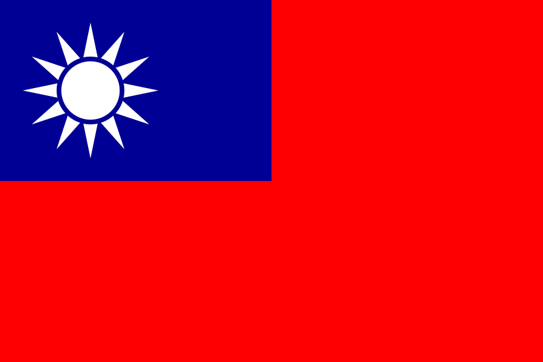

# QuadFight 🇹🇼

 [English](README.md) · **繁體中文**

> **免費、非營利的個人興趣專案。** QuadFight 是作者為了好玩、自己遊玩而做的作品：完全免費，沒有廣告、
> 沒有內購、沒有收款或贊助，也不從中獲利。本專案為獨立作品，與任何其他遊戲或公司沒有關聯，也未獲其背書或贊助。

以 Godot 4.7 製作的單人落塊益智遊戲：起始畫面、分數、本機排行榜、12 位角色（各有絕招）的 VS 電腦對戰，以及雙人對戰。
支援鍵盤／手把／觸控。

**直接在瀏覽器遊玩：** <https://jfcc-github.github.io/quadFight/>

## 下載

請到 [Releases 頁面](https://github.com/JFCC-GITHUB/quadFight/releases/latest) 下載最新版本。

| 平台 | 檔案 | 執行方式 |
|---|---|---|
| Windows 10/11（64 位元） | `QuadFight-<版本>-windows-x64.zip` | 解壓縮後雙擊 `QuadFight.exe` |
| macOS 11 以上（Apple 晶片與 Intel） | `QuadFight-<版本>-macos-universal.zip` | 解壓縮，將 `QuadFight.app` 移到「應用程式」，開啟（見下方說明） |
| Linux（x86-64） | `QuadFight-<版本>-linux-x86_64.tar.gz` | `tar xzf …` 後執行 `./QuadFight.x86_64` |
| 網頁版（現代瀏覽器，含 iOS Safari） | `QuadFight-<版本>-web.zip` 或上方連結 | 以 HTTP 伺服器架設該資料夾，或直接使用線上連結 |

每個壓縮檔都附有遊戲本體、`LICENSE`、`THIRD_PARTY_NOTICES.md`、`PRIVACY.md` 與 Godot 授權文件。

### 安裝檔未經程式碼簽章
程式碼簽章憑證需要付費，而本專案是免費的興趣作品，所以 Windows 與 macOS 版本**沒有簽章**，系統第一次開啟時會出現警告。
遊戲不含任何網路程式碼，也不蒐集任何資料（見 [PRIVACY.zh-TW.md](PRIVACY.zh-TW.md)）。
你可以用每個發行版附帶的 `SHA256SUMS.txt` 檢查下載檔是否與作者發布的一致：

```
sha256sum -c SHA256SUMS.txt          # Linux / macOS 請用：shasum -a 256 -c SHA256SUMS.txt
Get-FileHash QuadFight-*.zip         # Windows PowerShell，再與檔案內容比對
```

- **Windows（SmartScreen）：** 出現「Windows 已保護您的電腦」→ 點 **其他資訊** → **仍要執行**。
- **macOS（Gatekeeper）：** 對 `QuadFight.app` 按右鍵 →「打開」→ 再按「打開」。若顯示「已損毀」，請在「終端機」執行一次
  `xattr -dr com.apple.quarantine /Applications/QuadFight.app`。
- **Linux：** 若無法啟動，先執行 `chmod +x QuadFight.x86_64`。需要支援 OpenGL 3.3 的顯示卡與驅動程式（GL Compatibility 繪圖器）。

## 操作
| | 鍵盤 | 手把 | 觸控 |
|---|---|---|---|
| 左右移動 | ← → / A D | 十字鍵／左搖桿 | `<` `>` |
| 軟降 | ↓ / S | 十字鍵下 | `v` |
| 旋轉 | ↑ X / Z | A / B | ROTATE |
| 硬降 | Space | 十字鍵上 / Y | DROP |
| 暫存 | C / Shift | X | HOLD |
| 暫停 | P / Esc | Start | 右上角 ⏸ |

按鍵可在 OPTIONS → KEYS 自訂。

## 遊戲模式
- **PLAY**：單人無盡模式，有本機排行榜。
- **VS CPU**：與電腦對戰（Lv 1–20，電腦像人一樣有延遲、思考和失誤），先被堆到頂的人輸；12 位角色各有絕招。
  可打 **LADDER 天梯**（單一對手，每贏一場等級 +1）或 **TOURNAMENT 錦標賽**（5 位隨機角色，最後是你自己角色的「黑暗版」魔王；有續關、打車獎勵關）。
  - 電腦等級 = 反應速度、移動速度、失誤率（Lv1 約 28% 的方塊會放錯、動作慢；Lv10 幾乎不失誤、約人類高手的速度；Lv20 為頂尖人類）
  - 消行會攻擊對手：一次消 1 行約掉 1–2 格、2 行 3–4 格、3 行 5–7 格、4 行 8–10 格（連續消行每多一次再 +1，最多 10 格），灰色方格會隨機落在對手的各欄位
  - 你消行時，會先抵銷你自己還沒落下的待受攻擊方格，剩下的才送給對手；待落下的方格會顯示在「INCOMING」與棋盤左側的紅色警示條
  - 每個等級都會記錄你的勝敗
- **PRACTICE**：與指定對手打一場不計入紀錄的練習賽，結果卡可直接再戰。
- **2 PLAYERS**：本機雙人對戰——同一台電腦（兩組鍵盤區／兩支手把）或平板（兩組觸控按鈕）。

## 選項（標題畫面或暫停選單 → OPTIONS）
- **COLORS**：方塊配色 4 種（Candy / Neon / Pastel / Colorblind）、背景 3 種（Nebula / Midnight / Sunset）
- **SOUND**：音效、音樂各自的開關與音量；音效風格 2 種（Arcade / Soft & Relaxed 柔和）；音樂風格 7 種（Super Robot 熱血機器人動畫風〔預設〕/ Chiptune / Synthwave / Chill / Lo-fi Cafe / Bossa Breeze / Music Box），按箭頭即可試聽
- **CONTROLS / KEYS**：觸控版型（Classic / Thumbs）、左右手對調、長按移動速度、落點預覽開關、按鍵自訂
- 設定儲存在本機（網頁版存在瀏覽器儲存空間），下次開啟自動套用

## 美術與音樂
- 視覺素材由 `tools/` 內的 Python 腳本（Pillow + numpy）生成到 `assets/`：`gen_assets.py`（方塊、背景、Logo、圖示）、`gen_fighters.py`、`gen_fx.py`、`gen_car.py`。重跑後再執行 `godot --headless --import`。
- 字型：Russo One、Rajdhani（Google Fonts，SIL Open Font License，授權檔在 `assets/fonts/`）
- 音樂全部是原創曲，由 `tools/gen_music.py`／`tools/gen_themes.py`（numpy + soundfile）合成為可無縫循環的 OGG。
  Super Robot 風格只是參考 70–80 年代日本超級機器人動畫主題曲的整體氛圍，沒有重現任何現有歌曲。

## 從原始碼建置
用 **Godot 4.7** 開啟專案資料夾，按 F5。`export_presets.cfg` 已有 Web、Windows Desktop、Linux、macOS 匯出預設：

```
godot --headless --import
godot --headless --export-release "Linux"           build/linux/QuadFight.x86_64
godot --headless --export-release "Windows Desktop" build/windows/QuadFight.exe
godot --headless --export-release "macOS"           build/macos/QuadFight.zip
godot --headless --export-release "Web"             build/web/index.html
```

發行版由 GitHub Actions 建置：推送 `v*` 標籤會執行 `.github/workflows/release.yml`，匯出四個平台、產生 `SHA256SUMS.txt`，
並用 `RELEASE_NOTES.md` 發布 GitHub Release。合併到 `main` 會重新部署網頁版到 GitHub Pages（Settings → Pages → Source 選 **GitHub Actions**）。

## 專案結構
- `scripts/game.gd` 遊戲核心（SRS 旋轉、7-bag、hold、ghost、DAS/ARR、鎖定延遲）；`scripts/pieces.gd` 方塊與踢牆資料
- `scripts/cpu_player.gd`、`characters.gd` 電腦對手與 12 位角色
- `scripts/scores.gd`、`settings.gd` 本機排行榜與選項（autoload）
- `scripts/title.gd`、`main.gd` 等：畫面與輸入設定

## 發行說明與更新紀錄
[RELEASE_NOTES.zh-TW.md](RELEASE_NOTES.zh-TW.md) · [CHANGELOG.zh-TW.md](CHANGELOG.zh-TW.md)

## 法律聲明
- **授權：** 程式碼、自製美術與音樂採用 [PolyForm Noncommercial License 1.0.0](LICENSE)：任何非商業用途（遊玩、學習、興趣、教育、公益）皆免費；**商業使用需取得作者書面許可**。屬於「原始碼公開」而非 OSI 定義的「開放原始碼」。繁體中文白話摘要：[LICENSE.zh-TW.md](LICENSE.zh-TW.md)（以英文原文為準）。第三方部分仍依各自授權（見下）。v1.0.0 以 MIT 授權發行，該版本仍可依 MIT 使用；v1.0.1 起改採 PolyForm Noncommercial。
- **第三方元件**（Godot 引擎、字型）：見 [THIRD_PARTY_NOTICES.zh-TW.md](THIRD_PARTY_NOTICES.zh-TW.md) 與 `licenses/godot/`。
- **隱私：** 不蒐集、也不傳送任何資料，見 [PRIVACY.zh-TW.md](PRIVACY.zh-TW.md)。
- **免責聲明：** 本軟體依「現狀」（AS IS）提供，不附任何形式的保證（詳見授權條款）。未簽章的執行檔請自行斟酌使用。
- **商標：** 「Tetris」為其權利人的註冊商標；QuadFight 為獨立作品，與 The Tetris Company、Tetris Holding 或任何其他遊戲發行商均無關聯。
  其他產品名稱（Godot、Windows、macOS、Linux、iOS、Safari 等）屬各自權利人所有，僅用於說明相容性。
- **貢獻：** 歡迎以 Pull Request 貢獻；提交即表示你同意以相同的 PolyForm Noncommercial 授權釋出，並允許作者另行再授權（例如商業授權）。請勿加入第三方商標、抄襲的美術、音樂或旋律。

---
Made in Taiwan 🇹🇼 · 台灣製作 🇹🇼
